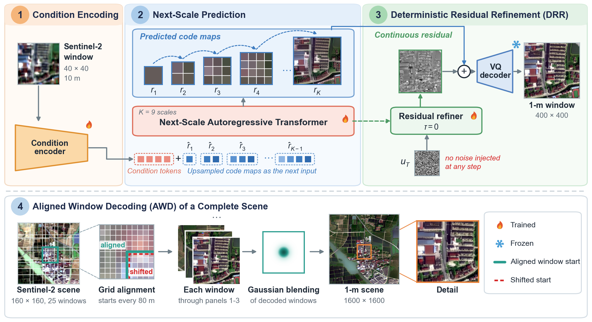
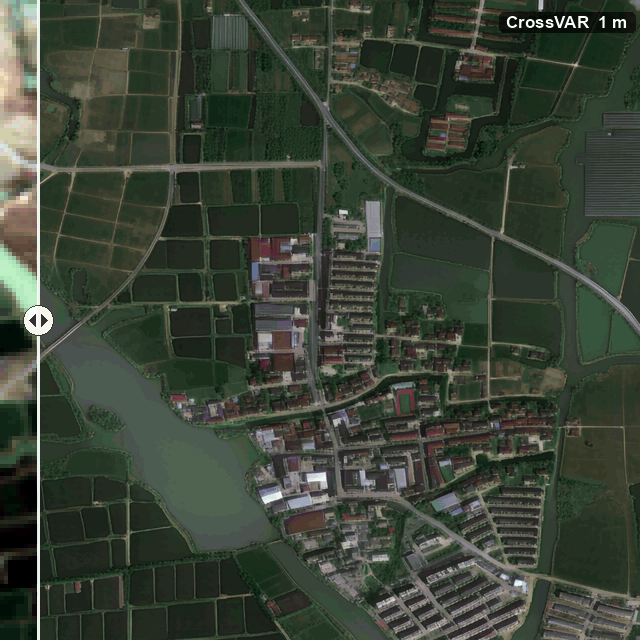
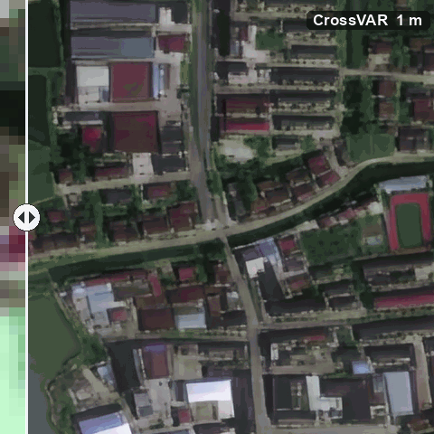
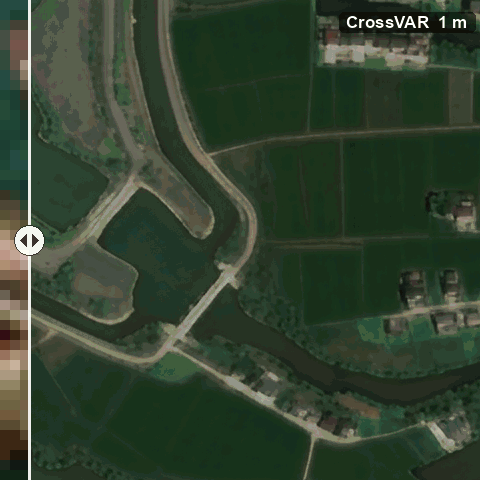
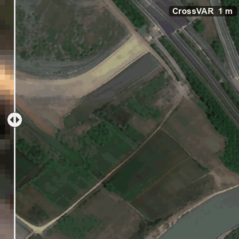
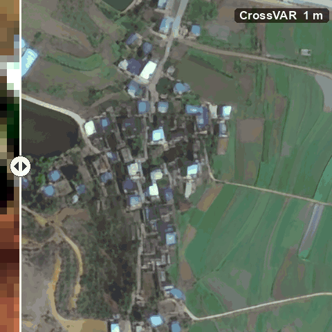

# CrossVAR

**From Sentinel-2 to 1-m Imagery: Real-World ×10 Cross-Sensor Super-Resolution via Visual Autoregressive Modeling**

<p align="center"></p>

CrossVAR reconstructs 1-m RGB imagery from a single 10-m Sentinel-2 RGB composite. A next-scale transformer predicts the
1-m latent as nine code maps from 1×1 to 25×25 conditioned on the Sentinel-2 input, **deterministic residual refinement**
estimates the remaining quantization residual without injected noise, and **aligned window decoding** reconstructs
complete 1600×1600 scenes from windows that start on the Sentinel-2 pixel grid and are decoded at the training size.

## Demo

<h2 align="center">
  <a href="https://shanoal.github.io/RSSR/">&#128073; Interactive comparison: drag the divider on complete scenes</a>
</h2>

<p align="center"></p>
<p align="center">Complete 1.6 &times; 1.6 km test scene: Sentinel-2 10 m input (left) and CrossVAR 1 m output (right).</p>

<table>
  <tr>
    <td align="center"><br>Urban</td>
    <td align="center"><br>Water</td>
  </tr>
  <tr>
    <td align="center"><br>Transport</td>
    <td align="center"><br>Rural</td>
  </tr>
</table>

The crops are 480 &times; 480 m at full 1-m resolution; the Sentinel-2 input is contrast-stretched and shown with its
original 10-m pixels. `scripts/make_demo.py` regenerates these files from the test predictions.

## Installation

```bash
conda create -n crossvar python=3.10 -y
conda activate crossvar
pip install -r requirements.txt
```

## Data

Training and validation use 40×40 Sentinel-2 / 400×400 1-m tile pairs, and testing uses complete 160×160 / 1600×1600
scenes. Inputs are GeoTIFFs with the RGB bands first; Sentinel-2 reflectance may be stored as float or as DN×10000.

```
datasets/
├── train/{LR,HR}/   40×40 and 400×400 tiles with identical file names
├── val/{LR,HR}/
└── test/{LR,HR}/    160×160 and 1600×1600 scenes
```

`scripts/crop_train_tiles.py` crops paired GeoTIFFs into tiles and splits them by source scene.

## Training

```bash
CUDA_VISIBLE_DEVICES=0,1,2 bash scripts/train.sh checkpoints/init.pth
```

`checkpoints/init.pth` holds the transformer and the VQ autoencoder that training starts from. The script follows the
recipe of the paper, three GPUs with one image each; the weights after every epoch are saved to
`results/crossvar/ar-model-epXXX.pth`, and the paper uses those of the third epoch.

## Inference and evaluation

```bash
CUDA_VISIBLE_DEVICES=0 bash scripts/infer.sh checkpoints/crossvar.pth checkpoints/vqvae.pth datasets/test
```

Predictions are written to `datasets/test/VARPrediction`, and PSNR, SSIM, LPIPS, and FID to `datasets/test/metrics.json`.
The main options of `infer.py` are

| Option | Default | Meaning |
|---|---|---|
| `--refine_temperature` | `0` | noise scale of the residual refiner; 0 is deterministic residual refinement |
| `--fusion` | `rgb` | `rgb`: windows decoded on their own and blended; `latent_window`, `latent`, `none` for comparison |
| `--overlap` | `5` | window overlap in latent positions; 5 starts every window on the input grid |
| `--export_stages` | | folder for the decoded latent after every scale |

## Citation

```bibtex
@misc{chen2026crossvar,
  title  = {From Sentinel-2 to 1-m Imagery: Real-World x10 Cross-Sensor Super-Resolution via Visual Autoregressive Modeling},
  author = {Chen, Tailai and Fu, Yuluxin and Deng, Jie and Wu, Yanan and Hong, Danfeng},
  year   = {2026},
  note   = {Under review}
}
```

## Acknowledgements

This code builds on [VARSR](https://github.com/qyp2000/VARSR) and [VAR](https://github.com/FoundationVision/VAR), and the
metrics use [pyiqa](https://github.com/chaofengc/IQA-PyTorch). We thank the authors for releasing their code.

## License

MIT, see [LICENSE](LICENSE).
